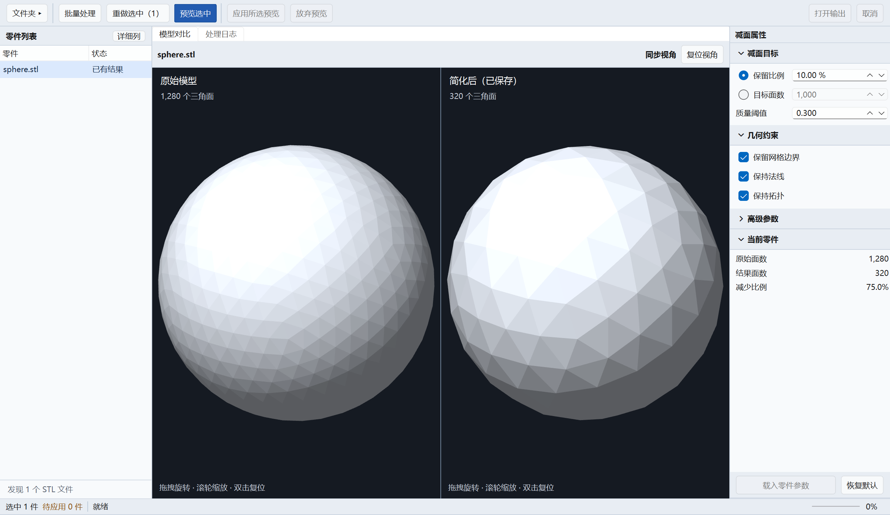

# STL 批量减面工具

Windows 桌面工具：批量简化 STL 三角网格，在同步的 OpenGL 视窗中对比原件与结果。可为选中的一个或多个零件单独调整参数，预览满意后再保存。

- 按保留比例或目标三角面数减面，支持边界、法线和拓扑等选项。
- 支持中文路径和文件名，可递归处理并保留目录结构。
- 默认保留约 10% 的三角面。原始 STL 保持不变；批量处理默认跳过输出目录中的同名文件。



## 使用

选择输入和输出文件夹，设置参数后点击「批量处理」。如果只想尝试某几个零件，在左侧列表中单选或多选，修改参数后点「预览选中」。中间两个视窗会同步旋转和缩放。效果合适时点「应用所选预览」，把当前预览写入输出目录。应用预览会覆盖对应的输出 STL。

详细步骤和参数见 [使用说明](docs/使用说明.txt)。

## 从源码运行

在 Windows 10/11 64 位上使用 Python 3.12，在仓库根目录运行以下 PowerShell 命令：

```powershell
py -3.12 -m venv .venv
.\.venv\Scripts\python.exe -m pip install -r requirements.txt
.\.venv\Scripts\python.exe .\src\stl_batch_simplifier_qt.py
```

减面使用 PyMeshLab 的二次误差边折叠算法；界面使用 PySide6，三维预览需要可用的 OpenGL。

## 打包 EXE

```powershell
.\.venv\Scripts\python.exe -m pip install -r requirements-build.txt
.\.venv\Scripts\python.exe -m PyInstaller --noconfirm --clean .\STL_Batch_Simplifier.spec
```

生成位置：`dist\STL_Batch_Simplifier_v1.7.exe`。打包后的 EXE 可在 Windows 上运行，无需另外安装 Python 或 MeshLab。

## 验证

```powershell
.\.venv\Scripts\python.exe .\src\stl_batch_simplifier_qt.py --self-test
$env:PYTHONPATH = (Resolve-Path .\src).Path
.\.venv\Scripts\python.exe .\tests\verify_selected_parts.py
.\.venv\Scripts\python.exe .\tests\verify_draft_preview.py
.\.venv\Scripts\python.exe .\tests\verify_gl_preview.py
.\.venv\Scripts\python.exe .\tests\verify_workbench_layout.py
```

界面检查需在支持 OpenGL 的 Windows 桌面会话中运行。脚本自动生成测试球体，验证中文路径、选择性重做、临时预览的应用与放弃、OpenGL 绘制及窗口布局。样件和截图写到本地 `.test-artifacts/`。
